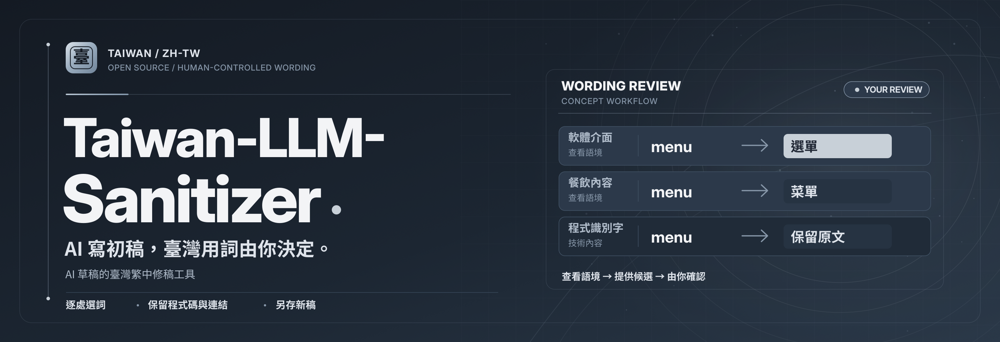

<!-- HUMAN_TRANSLATION_REVIEW: pending independent native-speaker review -->
<!-- SOURCE_README_SHA256:ddaeab0c6f5c8edb959806dc517e51d3734d1aa57bf8728d264ca0d5a0b360b4 -->

# Taiwan-LLM-Sanitizer — 안전을 우선하는 대만 번체 중국어 현지화

<!-- TLS_BRANDING_R3_BEGIN -->

*Workflow illustration, not an actual app screenshot. You review every proposed edit.*
<!-- TLS_BRANDING_R3_END -->

**Languages:** [繁體中文](README.md) · [简体中文](README.zh-CN.md) · [English](README.en.md) · [日本語](README.ja.md) · [한국어](README.ko.md) · [Español](README.es.md)

<!-- R176_SHOWCASE_BEGIN -->
### AI가 초안을 쓰고, 타이완 용어는 직접 선택하세요.

하나의 Markdown에서 UI의 `menu`는 「選單」, 음식의 `menu`는 「菜單」으로 선택하고 세 번째 표현은 원문으로 남길 수 있습니다. 각 선택을 확인한 뒤 새 파일로 내보내며 기술 구간을 우선 보호합니다.

**[첫 문서 검토 시작](https://github.com/MAX67-gif/Taiwan-LLM-Sanitizer-Traditional_Chinese-zh_tw/releases/latest)** — 다운로드: `TW_Wording_Assistant_R172_20261027.html`，로컬 브라우저에서 여세요.

[실제 사용 안내 보기 (영어)](docs/showcase/README.en.md) · [실제 미리보기 결과](docs/showcase/preview.md)

기존 R17.2를 사용한 예시입니다. 제안 범위는 제한적이며 사람의 검토가 필요합니다. 60초는 안내의 설계 길이이며 측정된 작업 시간이 아닙니다.
<!-- R176_SHOWCASE_END -->

<!-- R19_FIRST_USE_BEGIN -->
### 처음 사용: R19로 Markdown 한 문서 검토

**[① 최신 공식 릴리스 열기](https://github.com/MAX67-gif/Taiwan-LLM-Sanitizer-Traditional_Chinese-zh_tw/releases/latest)**. Assets에서 `TLS_ALL_TOOLS_SUITE_17_4_0.zip` 또는 `TW_First_Result_Studio_R19_20261101.html`을 받으세요. 실제 공개된 첨부 파일 이름을 확인하세요.

**② 압축을 풀고 로컬 브라우저에서 `START_HERE.html`을 열어 R19 First Result Studio를 선택하세요. ③ 원본 예제나 자신의 Markdown을 불러와 각 항목을 채택 또는 유지하고, 차이를 확인한 뒤 새 파일로 저장하세요.** 문맥 설정은 힌트이며 편집은 매번 직접 결정합니다.

[3단계 안내](docs/QUICK_START_R174.en.md) · [연습 문서](docs/R174_ORIGINAL_FIRST_TASK.md) · [R19 안내와 제한](docs/r19/README.en.md). Suite 17.4.0은 기존 28개 도구를 유지하며 **29개 도구 / 독립 도구 자산 24개**를 포함합니다. R19는 오프라인 엔지니어링 미리보기이며 사람의 사용성 및 언어 품질은 검증되지 않았습니다. GitHub HTML 소스는 다운로드한 뒤 로컬에서 여세요.
<!-- R19_FIRST_USE_END -->

사용자가 대만 용어를 직접 선택하고 원문과 번역문을 비교하며 기술 문서의 구조를 보호할 수 있는 오픈소스 도구입니다. 제3자 서비스의 공식 제품이 아닙니다. **MIT** · Founder / Steward: CA L.
### R17.2｜AI 중국어 문서를 대만 용어에 맞게 검토

[시작하기](START_HERE.html) · [오프라인 대만 용어 검토](examples/TW_Wording_Assistant_R172_20261027.html) · [Codex·Claude·Grok 가이드](docs/AI_WORKFLOWS_CODEX_CLAUDE_GROK.en.md). 사용 권한이 있는 중국어 Markdown을 붙여넣고 각 제안을 직접 선택한 다음 구조 검사를 거친 새 파일을 저장합니다. 자동 클라우드 번역이나 Grok 직접 연동, 언어 품질 인증 기능은 없습니다.

<!-- R177_MRFT_BEGIN -->
### R17.7｜읽을 위치를 영역으로 지정하기 (별도 Chrome Preview 0.1.0)

현재 탭에서 명시적으로 동의한 뒤 드래그하여 **독립적인 번역 영역을 최대 8개** 만들 수 있습니다. `FOLLOW_DOM`은 원래 요소를 따라가고, `FIX_VIEWPORT`는 화면 좌표에 고정됩니다. 이동, 크기 조절, 일시 정지, 다시 지정, 모두 닫기가 가능합니다. 영역 안에 보이는 일반 DOM 텍스트만 읽으며 원래 페이지의 글은 바꾸지 않습니다.

기본 경로는 **번역문을 직접 붙여 넣기**입니다. 로컬 Translator API는 별도로 활성화하며 모델 다운로드가 필요하면 명시적인 동의를 받습니다. 사용할 수 없으면 `MODEL_UNAVAILABLE`을 표시하고 실시간 번역인 것처럼 보이지 않습니다. 공개된 비민감 콘텐츠에만 사용하세요. OCR, Canvas/WebGL, iframe, 클라우드 전송은 지원하지 않으며 표시되지 않은 모든 사적 내용을 자동으로 알아낼 수도 없습니다. 번역 품질은 사람이 확인해야 합니다.

**[전체 Suite 17.3.0 다운로드](https://github.com/MAX67-gif/Taiwan-LLM-Sanitizer-Traditional_Chinese-zh_tw/releases/tag/all-tools-suite-v17.3.0)**: 도구 28개, 독립 도구 자산 23개, Release 첨부 파일 28개입니다. 기존 도구 27개의 버전과 바이트는 유지됩니다. 새 설치 파일 `TLS_Chrome_MV3_MRFT_R177_20261031.zip`에는 자체 제작 연습 페이지가 포함됩니다. **[설치, 사용법, 제한 사항](docs/mrft/MRFT_DOM_PREVIEW.md)** (번체 중국어). Chrome Web Store 심사나 사람에 의한 언어 품질 인증을 받은 것은 아닙니다.
<!-- R177_MRFT_END -->

### TCR 2.0｜선택형 오프라인 문맥 검토 Skill

[TCR 2.0 안내](skills/taiwan-context-reviewer/README.en.md)에서는 대만 용어 후보를 검토하고 권한 있는 Markdown 초안과 수정본의 코드, 숫자, 링크 보존 여부를 확인할 수 있습니다. 자동 수정이나 번역 품질 인증은 제공하지 않습니다. 처음 사용한다면 위의 오프라인 문서 수정 도구부터 시작하세요.

## 사용 가능한 기능

| Release | Scope | Status |
| --- | --- | --- |
| **R13** | Local selection-based bilingual reading, no page-text rewrite | v0.6.0 Preview |
| **R11** | Explicit per-site personal glossary and conservative rollback | v0.5.0 Preview |
| **R14** | Offline provider capability / consent declarations; no remote transport | Research preview |
| **R15** | Markdown/JSON/Prompt 구조 보호 및 SHA256 기반 로컬 변경 미리보기 | 독립 미리보기 |
| **R12 / R6** | Frozen 100-case coverage and structural audit; not model correctness | Evaluation only |
| **R5, R8–R10** | Earlier lexical, human-choice and offline research tools | Preview / prototype |

[Releases](https://github.com/MAX67-gif/Taiwan-LLM-Sanitizer-Traditional_Chinese-zh_tw/releases) · [R13 bilingual reader](https://github.com/MAX67-gif/Taiwan-LLM-Sanitizer-Traditional_Chinese-zh_tw/releases/tag/r13-bilingual-reader-preview-0.6.0) · [R11 glossary](https://github.com/MAX67-gif/Taiwan-LLM-Sanitizer-Traditional_Chinese-zh_tw/releases/tag/r11-manual-site-glossary-0.5.0).

## R15 — Local structure-preview toolkit

[R15 오프라인 구조 보호 도구](examples/TW_Structured_Integrity_Lab_R15_20261025.html)는 코드, JSON 키, URL, 역할과 변수를 보호하고 사용자가 지정한 변경 내용만 미리 보여 줍니다. 자동 번역이나 원본 파일 수정은 하지 않습니다.

## 일반 웹사이트에서 활용하기

공통 안내서에서 텍스트 선택 번역, 개인 용어 설정, 변경 취소 방법을 설명합니다. 특정 게임용 스크립트, 사전, 패치나 타사 자산은 배포하지 않습니다. 사이트 약관과 권리를 반드시 확인하세요. **[Universal website localization guide](docs/WEBSITE_LOCALIZATION_GUIDE.md)**.

## 이 프로젝트의 특징

문맥에 맞는 대만 용어, 코드 및 JSON 키 보호, 명확한 승인과 조건부 복원, 로컬 우선 처리, 검증 가능한 설명에 집중합니다.

## 저작권·상표·개인정보 보호

공개된 자료라고 해서 번역하거나 재배포할 권리가 있는 것은 아닙니다. 비영리·출처 표시·비공식 표기만으로 허가를 얻는 것은 아닙니다. [Third-party rights policy](docs/THIRD_PARTY_RIGHTS_POLICY.md) · [Privacy](PRIVACY.md) · [Security](SECURITY.md).

모든 기능은 미리보기입니다. 번역 정확도, 모든 사이트와의 호환성 또는 제3자 허가를 보장하지 않습니다.

## 문서 및 참여

[Documentation](docs/FEATURES.md) · [Roadmap](docs/ROADMAP.md) · [Contributing](CONTRIBUTING.md) · [Major updates](CHANGELOG.md).

## 직접 만든 사용 예제 9가지

[원본 권리를 침해하지 않는 9가지 예제](docs/USAGE_EXAMPLES.ko.md) (EX01–EX09): 대만 표현 선택, R13 수동 선택형 읽기, R11 사용자 용어집, R14 모델 능력 표시, R15 Markdown／JSON／Prompt 보호.

**가상의 웹 게임 형태 페이지**에서 `Open settings`가 선택 가능한 일반 HTML 글자라면 사이트 이용 약관이 허용할 때 R13 또는 R11로 보조할 가능성이 있습니다. Canvas／WebGL에 직접 그려진 글자는 지원하지 않습니다. 실제 게임 호환성을 확인했다고 주장하지 않으며 특정 게임용 스크립트나 사전도 배포하지 않습니다. [일반 웹사이트 안내](docs/WEBSITE_LOCALIZATION_GUIDE.md).

## R16｜오프라인 현지화 안전 워크벤치(독립 Shadow Preview)

[R16 오프라인 도구](examples/TW_Localization_Safety_Studio_R16_20261026.html) · [사용법 및 안전 제한](docs/R16_LOCALIZATION_STUDIO.md) · [직접 작성한 Markdown 예제](examples/r16/sample_readme.md). Markdown／JSON／Prompt의 보호 구간을 검사하고 후보 문구를 직접 입력한 뒤 차이를 검토하여 **새** 미리보기 파일로 저장합니다. 메타데이터 보고서는 원문을 포함하지 않지만 사용자가 내려받는 미리보기에는 직접 입력한 문구가 포함될 수 있습니다. **자동 번역, 클라우드 전송, 원본 덮어쓰기는 없습니다**. 모든 문법이나 번역 품질을 보증하지 않습니다.

## R17｜오프라인 문서 링크 무결성 검사(읽기 전용)

[R17 Markdown 링크 검사 열기](examples/TW_Document_Trust_Graph_R17_20261026.html) · [사용법 및 한계](docs/R17_DOCUMENT_TRUST_GRAPH.ko.md). 권한이 있는 Markdown 파일을 직접 선택하고 상대 링크와 제목 앵커를 검사합니다. 원문을 포함하지 않는 메타데이터 보고서만 내보냅니다. 외부 또는 알 수 없는 링크는 UNKNOWN으로 남기며 네트워크 요청을 보내지 않습니다. **번역하거나 원본 파일을 수정하지 않습니다.**

## R17.1｜모든 Release에 지원 중인 전체 도구 포함

[전체 도구 배포 및 무결성 안내](docs/ALL_TOOLS_RELEASE.md)를 확인하세요. 새로운 공식 Release에는 합법적으로 배포 가능하고 지원 중인 Chrome 확장, Tampermonkey 스크립트, 오프라인 HTML 작업대 13개, R6 품질 연구 키트, CLI/Skill 개발자 묶음이 모두 포함되어야 합니다. 변경되지 않은 도구는 원래 버전과 SHA256을 유지합니다. Draft의 모든 첨부 파일을 확인한 다음 공개합니다. 기존에 권리 문제로 철회한 제3자 전용 패키지는 제외합니다. 실제 GitHub CI 및 첨부 파일 검사가 성공한 뒤에만 [R17.1 Release](https://github.com/MAX67-gif/Taiwan-LLM-Sanitizer-Traditional_Chinese-zh_tw/releases/tag/all-tools-suite-v17.1.0)를 사용하세요.

**R17.3은 연구 전용:** [동일한 편집 가능 구간의 공정한 비교 및 자발적 사용 검증 계획](docs/R173_COMPARISON_AND_ADOPTION.en.md)을 참고하세요. **OpenCC·LLM 대비 우월성 또는 독립적인 사람의 언어 품질 검증 결과는 아직 없습니다.** R17.2 검토 도구 자체는 변경하지 않습니다. 이전 17.1/17.2 통합 ZIP은 공개 범위 검토 후 철회되었으므로 전체 패키지는 GitHub 최신 공식 릴리스에서 다운로드하세요.

<!-- ALL_TOOLS_CATALOG: suite=17.4.0; tools=29; standalone=24; tool_ids_sha256=cf54846ecef37ae118b8bba1325f5214e8db00c9f4c404093eef69e664820404 -->

배포 검사는 실제 도구와 다운로드한 파일을 원본에 고정된 SHA256 및 Git 커밋과 대조합니다. Draft 단계와 공개 후 각각 다운로드하며, 기존 태그는 덮어쓰지 않고 검증합니다. 여섯 언어 안내는 아직 사람의 검토를 기다립니다(HUMAN_TRANSLATION_REVIEW_PENDING).
